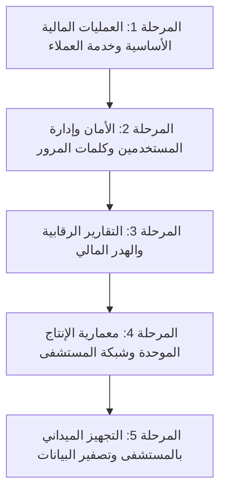

# 🏪 منظومة إدارة الكانتين المتكاملة (Canteen Management System)
### 🏥 المستشفى العسكري ق.م بالإسماعيلية

> **منظومة برمجية متكاملة لإدارة الكانتين والبوفيه، نقاط البيع السريعة، المخزون وتواريخ الصلاحية، حسابات وأمانات المرضى، فواتير الموردين والمشتريات، الخزائن والورديات اليومية، والنسخ الاحتياطي التلقائي المحمول.**  
> مصممة للعمل بكفاءة مطلقة على بيئات **Windows 7 SP1** وما فوق، برامات 4GB أو أقل، وبدون الحاجة لإنترنت نهائياً (Offline LAN Architecture).

---

## 🌟 الميزات الرئيسية للنظام

### 1. نقطة البيع السريعة (POS Pro)
- شبكة أصناف تفاعلية تدعم مسح الباركود السريع والبحث الفوري والتصنيفات.
- اختصارات لوحة المفاتيح الكاملة لسرعة الخدمة في الطوابير:
  - `F2`: التركيز الفوري على حقل البحث والباركود.
  - `F4`: التبديل السريع بين الدفع النقدي والبيع على حساب المريض.
  - `F9`: إنهاء وطباعة الفاتورة كاش فوري.
  - `Esc`: مسح البحث أو إغلاق النوافذ.
- أصوات تفاعلية عبر تقنية Web Audio API للتأكيد على نجاح المسح أو التنبيه.
- **تنبيهات الصلاحية والمخزون:** شارات حمراء وبرتقالية توضح الأصناف المنتهية أو التي أوشكت صلاحيتها على الانتهاء، ودعم البيع بالسالب مع إشعار عند نفاد المخزون.
- طباعة البون الحراري (Thermal 80mm / 58mm) مع مفتاح تحكم لتفعيل أو إيقاف طباعة البون تلقائياً.
- **قفل البيع التلقائي عند إغلاق اليومية:** حظر أي عمليات بيع خارج أوقات الوردية الرسمية.

### 2. محرك تواريخ الصلاحية الذكي وتتبع الهدر (Smart Expiry Engine)
- حقل **تاريخ الصلاحية (اختياري)** في كافة كروت الإضافة والتعديل وشاشات الشراء.
- محرك حساب آلي للتنبيه عند تبقي **5 أيام أو أقل** على انتهاء الصلاحية.
- صياغة عربية لغوية دقيقة للأيام المتبقية (`ينتهي اليوم!`، `متبقي يوم واحد`، `متبقي يومان`، `متبقي 3 أيام`، `متبقي 5 أيام`).
- تنبيهات واضحة بالكاشير والإدارة وتبويبات فلترة سريعة بالأصناف المنتهية والوشيكة.
- تقرير مالي متخصص لحساب تكلفة الهدر المالي المتوقع للبضاعة التالفة.

### 3. إدارة الورديات ونظام اليومية المستمر (Daily Shift Engine)
- دورة حياة متكاملة لليومية (`DailyShift`): فتح اليومية برصيد بداية اليوم، وتقفيل الوردية بعد الجرد الفعلي للنقدية بالدرج.
- دعم كامل للورديات العابرة لمنتصف الليل دون أي تأثر بتقلبات التاريخ.
- احتساب العجز والزيادة تلقائياً مع ترحيل النقدية المحصلة من الدرج للخزينة وإصدار إيصال تقفيل معتمد.

### 4. الإدارة المالية والخزائن الثلاث المعتمدة
- تثبيت 3 قنوات مالية رسمية:
  1. `نقدي (الدرج)`: النقدية التشغيلية اليومية للكاشير.
  2. `فودافون كاش`: محفظة المعاملات الإلكترونية.
  3. `الخزينة (الرئيسية)`: الخزينة المركزية الآمنة لتوريد عهد الوردية والمدفوعات الكبرى.
- تحويل تبادلي مباشر بين القنوات دون اعتباره إيراداً أو مصروفاً، مع التحقق التام من الأرصدة المتوفرة.
- بنود سحب المصروفات الرسمية: (`سداد لمورد`، `نثريات تشغيلية`، `حساب مستشفى`).

### 5. ملفات المرضى والأمانات والمديونيات
- فصل محاسبي كامل بين:
  - `ديون المرضى للكانتين (مستحقة لنا)` للأرصدة المدينة (السالبة).
  - `أموال وأمانات المرضى المستحقة لهم (أمانات مودعة)` للأرصدة الدائنة (الموجبة).
- كشف حساب تفصيلي وسجل حركات ومشتريات لكل مريض.
- تصفية حساب المريض ونقله للأرشيف بنقرة زر مع رد المتبقي أو تحصيل المديونية تلقائياً عبر الخزينة.

### 6. كشف حساب الموردين وفواتير الشراء
- كشف حساب تفصيلي لكل مورد مع سجل تاريخي بكافة الفواتير والدفعات والمتبقي.
- فواتير مشتريات ذكية تدعم مسح الباركود وإنشاء أصناف جديدة وتحديد صلاحيتها فورياً أثناء الشراء.
- سداد دفعات للموردين نقداً أو عبر الخزينة مع خصم فوري للمديونية وتوثيق السندات.

### 7. محرك النسخ الاحتياطي التلقائي المحمول (Auto Backup Engine)
- أخذ نسخة احتياطية وقائية تلقائياً عند كل تشغيل للسيرفر.
- أخذ نسخة احتياطية تلقائية عند تقفيل كل وردية يومية، ونسخة يومية مجدولة عند الساعة 03:00 فجراً.
- مسارات ديناميكية محمولة 100% تعمل على أي مسار أو جهاز ويندوز دون اعتمادات ثابتة.
- واجهة إدارة كاملة تتيح تنزيل النسخ، استعادتها بأمان مع نسخة وقائية سابقة، وتحديد مسار خارجي للحفظ (External USB).

### 8. التقارير الرقابية والمالية (Reports & Analytics)
- تقرير الأرباح الحقيقية من المتاجرة (إجمالي المبيعات - تكلفة البضاعة المباعة COGS).
- تقارير تفصيلية للمبيعات، الورديات، المصروفات، المشتريات، الديون، والمخزون.
- هوية رسمية موحدة باسم **المستشفى العسكري ق.م بالإسماعيلية** في كافة الترويسات والمطبوعات.

---

## 🛠️ البنية التقنية والتوافق مع بيئة العمل

| المكوّن | التقنية المعتمدة | سبب الاعتماد |
|---|---|---|
| **الواجهة (Frontend)** | React 18 + Vite 5 + Tailwind CSS RTL | واجهة سريعة، مستهدفة لـ ES2015 لتعمل بسلاسة على المتصفحات القديمة والحديثة |
| **الخادم (Backend)** | Node.js (Express.js) | خفيف وسريع، متوافق مع كافة إصدارات الويندوز |
| **قاعدة البيانات** | SQLite (عبر Prisma ORM) | ملف محلي خفيف (< 20MB RAM) بدون سيرفرات خارجية معقدة |
| **الأمان والتشفير** | JWT + `bcryptjs` | كود جافاسكريبت نقي بنسبة 100% خالي من الاعتماديات الأصلية المجمعة |
| **الطباعة** | طباعة المتصفح المباشرة للحراري (80mm / 58mm) والـ A4 | بدون الحاجة لتعريفات معقدة |
| **الشبكة المحلية** | Offline Local LAN | يعمل بالكامل بدون إنترنت عبر الشبكة الداخلية للمستشفى |

---

## 🗺️ خريطة مراحل الجاهزية النهائية للإنتاج (5 مراحل تنفيذية)



| # | المرحلة الرئيسية | المراحل الفرعية (Sub-stages) | الحالة |
|:---:|---|---|:---:|
| **1** | **العمليات المالية الأساسية وتجربة العميل** | • **1.1:** تعديل بيانات المرضى (`PUT /api/patients/:id` + UI Modal)<br>• **1.2:** سداد دفعات الموردين المباشرة (Supplier Quick Pay Modal)<br>• **1.3:** تصحيح إشعار نجاح المرتجع من أحمر لأخضر<br>• **1.4:** إظهار رصيد المريض بعد البيع في بون الكاشير الحراري<br>• **1.5:** ضبط عداد أيام الصلاحية لغوياً وتنبيه الـ 5 أيام | 🟡 **قيد التنفيذ حالياً**<br>(1.5 مكتمل بالكامل) |
| **2** | **أمان المستخدمين وإدارة كلمات المرور** | • **2.1:** مسارات إعادة تعيين الباسورد وتعديل المستخدمين بالباك إند<br>• **2.2:** واجهة تغيير كلمة المرور للمستخدمين بالفرونت إند<br>• **2.3:** التسجيل الرقابي للحركات في سجل المراجعة `AuditLog` | ⏳ قادمة |
| **3** | **التقارير الرقابية وتتبع الهدر المالي** | • **3.1:** إدراج تقرير الصلاحية والهدر في قائمة شاشة التقارير<br>• **3.2:** جدول وكروت الهدر المالي وتكلفة الشراء التالفة<br>• **3.3:** جاهزية وهوامش الطباعة الرسمية للتقرير A4 | ⏳ قادمة |
| **4** | **معمارية الإنتاج الموحدة والشبكة** | • **4.1:** ديناميكية رابط الـ API للشبكة عبر `window.location.hostname`<br>• **4.2:** استضافة الواجهة على نفس منفذ الباك إند الموحد (Port 8000)<br>• **4.3:** سكربت التشغيل التلقائي بنقرة واحدة (`تشغيل_الكانتين.bat`) | ⏳ قادمة |
| **5** | **التجهيز الميداني والتسليم الفعلي** | • **5.1:** سكريبت تصفير البيانات التجريبية الآمن للبدء النظيف<br>• **5.2:** ضبط ومواءمة طابعة البونات الحرارية بالمستشفى (80mm/58mm)<br>• **5.3:** اختبار الوردية الحية الكاملة والاعتماد النهائي | ⏳ قادمة |

---

## 🚀 تعليمات التشغيل السريع

### تشغيل التطوير (Development):
```bash
# 1. تشغيل الباك إند (Port 8000)
node backend/src/index.js

# 2. تشغيل الواجهة (Port 5173)
cd frontend
npm run dev
```

### بيانات الدخول الافتراضية:
- **المدير / المشرف:** `admin` / كلمة المرور: `admin123`
- **الكاشير / المبيعات:** `sales` / كلمة المرور: `sales123`
