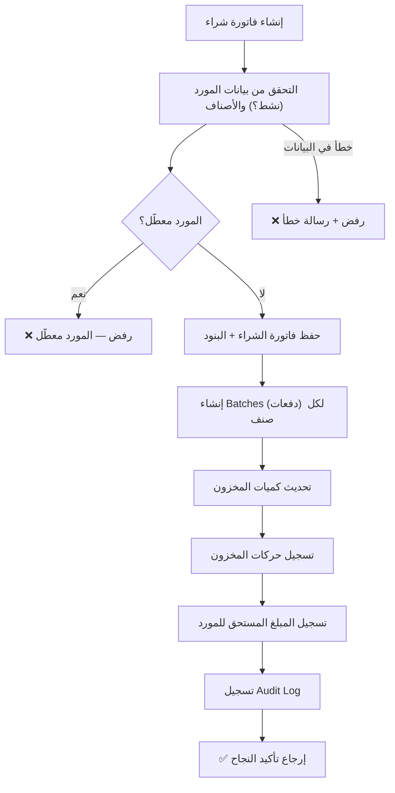
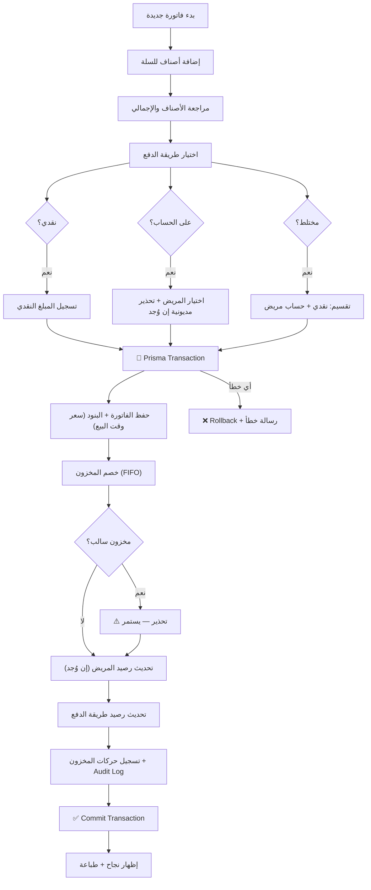
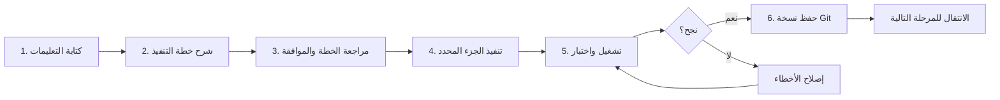

# 🏗️ خطة التنفيذ التفصيلية — نظام إدارة الكانتين (CanteenSystem)

> **تاريخ الإنشاء:** 2026-10-10
> **آخر تحديث:** 2026-10-15
> **المسار:** `D:\\كانتين\\CanteenSystem`
> **الحالة:** 🚀 **المراحل 1 إلى 9 مكتملة بنسبة 100% بالكامل** — جاري العمل على المرحلة 10 (النسخ الاحتياطي والأمان).

---

## 📋 ملخص التغييرات عن النسخة السابقة

| # | التغيير | قبل | بعد |
|---|---------|-----|-----|
| 1 | Backend | Python + FastAPI | **Node.js + Express.js** |
| 2 | ORM | SQLAlchemy + Alembic | **Prisma** |
| 3 | هيكل المشروع | Layer-based | **Feature-based** |
| 4 | السيرفر | غير محدد | **Windows 7/10, 4GB RAM** |
| 5 | القرارات المفتوحة | 11 قرار مفتوح | **تم حسم الكل** |

---

## 📋 الجدول الزمني

| # | المرحلة | المدة التقديرية | الأولوية | الحالة الفعلية |
|---|---------|----------------|----------|----------------|
| 1 | تجهيز المشروع وبيئة العمل | 1-2 يوم | 🔴 حرجة | ✅ مكتملة |
| 2 | المواصفات وتصميم قاعدة البيانات | 3-5 أيام | 🔴 حرجة | ✅ مكتملة |
| 3 | تأسيس البرنامج والسيرفر | 3-4 أيام | 🔴 حرجة | ✅ مكتملة |
| 4 | المستخدمون والصلاحيات | 3-4 أيام | 🔴 حرجة | ✅ مكتملة |
| 5 | الأصناف والمخزون والمشتريات | 5-7 أيام | 🔴 حرجة | ✅ مكتملة |
| 6 | ملفات المرضى وحساباتهم | 3-4 أيام | 🔴 حرجة | ✅ مكتملة |
| 7 | المبيعات والفواتير (POS) | 5-7 أيام | 🔴 حرجة | ✅ مكتملة |
| 8 | الخزينة وطرق الدفع والمصروفات والمرتجعات | 4-5 أيام | 🟡 مهمة | ✅ مكتملة |
| 9 | التقارير ولوحة التحكم المزدوجة | 4-6 أيام | 🟡 مهمة | ✅ مكتملة |
| 10 | سجل المراجعة والنسخ الاحتياطي | 3-4 أيام | 🟡 مهمة | 🟡 قيد التنفيذ (50% منجز) |
| 11 | تشغيل السيرفر والشبكة المحلية LAN | 2-3 أيام | 🟡 مهمة | ⏳ قادمة |
| 12 | الاختبارات النهائية والتسليم | 3-5 أيام | 🔴 حرجة | ⏳ قادمة |
| | **الإجمالي التقديري** | **39-56 يوم عمل** | |

---

## 🔧 التقنية المعتمدة

| المكوّن | التقنية | السبب |
|---------|---------|-------|
| **الواجهة (Frontend)** | React + Vite + Tailwind CSS | SPA سريعة، RTL جاهز، تعمل في أي متصفح |
| **الخادم (Backend)** | Node.js + Express.js | مألوف، سريع، ecosystem كبير |
| **قاعدة البيانات** | PostgreSQL | Transactions قوية، أداء ممتاز |
| **ORM** | Prisma | Type-safe، migrations سهلة، schema واضح |
| **المصادقة** | JWT + bcrypt | Stateless، آمن |
| **الطباعة** | PDF عبر المتصفح (html2pdf / jsPDF) | لا تحتاج طابعة خاصة |
| **تصدير التقارير** | ExcelJS + docx (قالب Word ثابت) | تقفيلة الشهر بقالب Word معتمد |
| **إدارة النسخ** | Git | تتبع التغييرات ونقاط الحفظ |

### بيئة السيرفر

| المواصفة | القيمة |
|----------|--------|
| **نظام التشغيل** | Windows 7 أو 10 (أسوأ حالة: Windows 7) |
| **RAM** | 4 GB |
| **الشبكة** | LAN محلية — بدون إنترنت |
| **الأجهزة** | 4 أجهزة متصلة عبر المتصفح |

> [!WARNING]
> Windows 7 لا يدعم Node.js 18+. سنستخدم **Node.js 16 LTS** (آخر إصدار يدعم Win7) أو نتأكد من إصدار Windows الفعلي أولاً. إذا كان Windows 10 فسنستخدم Node.js 20 LTS.

---

## 📁 هيكل المشروع المستهدف (Feature-Based)

```
CanteenSystem/
├── README.md
├── .gitignore
├── docker-compose.yml              # (اختياري) لتشغيل PostgreSQL
│
├── backend/
│   ├── package.json
│   ├── .env
│   ├── .env.example
│   ├── prisma/
│   │   ├── schema.prisma           # Prisma schema (كل الجداول)
│   │   ├── migrations/             # Prisma migrations
│   │   └── seed.js                 # بيانات أولية (أدمن، تصنيفات، طرق دفع)
│   ├── src/
│   │   ├── index.js                # Express entry point
│   │   ├── app.js                  # Express app setup, middleware, CORS
│   │   ├── config/
│   │   │   └── index.js            # env vars, constants
│   │   │
│   │   ├── common/                 # Shared utilities
│   │   │   ├── middleware/
│   │   │   │   ├── auth.js         # JWT verification
│   │   │   │   ├── permissions.js  # Role/permission checks
│   │   │   │   ├── audit.js        # Audit logging middleware
│   │   │   │   ├── errorHandler.js # Global error handler
│   │   │   │   └── idempotency.js  # Prevent duplicate operations
│   │   │   ├── utils/
│   │   │   │   ├── security.js     # bcrypt, JWT helpers
│   │   │   │   ├── pagination.js   # Pagination helper
│   │   │   │   ├── validators.js   # Shared validation
│   │   │   │   └── helpers.js      # General helpers
│   │   │   └── prisma.js           # Prisma client instance
│   │   │
│   │   ├── features/
│   │   │   ├── auth/
│   │   │   │   ├── auth.routes.js
│   │   │   │   ├── auth.controller.js
│   │   │   │   ├── auth.service.js
│   │   │   │   └── auth.validation.js
│   │   │   │
│   │   │   ├── users/
│   │   │   │   ├── users.routes.js
│   │   │   │   ├── users.controller.js
│   │   │   │   ├── users.service.js
│   │   │   │   └── users.validation.js
│   │   │   │
│   │   │   ├── products/
│   │   │   │   ├── products.routes.js
│   │   │   │   ├── products.controller.js
│   │   │   │   ├── products.service.js
│   │   │   │   └── products.validation.js
│   │   │   │
│   │   │   ├── inventory/
│   │   │   │   ├── inventory.routes.js
│   │   │   │   ├── inventory.controller.js
│   │   │   │   ├── inventory.service.js
│   │   │   │   └── inventory.validation.js
│   │   │   │
│   │   │   ├── suppliers/
│   │   │   │   ├── suppliers.routes.js
│   │   │   │   ├── suppliers.controller.js
│   │   │   │   ├── suppliers.service.js
│   │   │   │   └── suppliers.validation.js
│   │   │   │
│   │   │   ├── purchases/
│   │   │   │   ├── purchases.routes.js
│   │   │   │   ├── purchases.controller.js
│   │   │   │   ├── purchases.service.js
│   │   │   │   └── purchases.validation.js
│   │   │   │
│   │   │   ├── patients/
│   │   │   │   ├── patients.routes.js
│   │   │   │   ├── patients.controller.js
│   │   │   │   ├── patients.service.js
│   │   │   │   └── patients.validation.js
│   │   │   │
│   │   │   ├── invoices/
│   │   │   │   ├── invoices.routes.js
│   │   │   │   ├── invoices.controller.js
│   │   │   │   ├── invoices.service.js
│   │   │   │   └── invoices.validation.js
│   │   │   │
│   │   │   ├── treasury/
│   │   │   │   ├── treasury.routes.js
│   │   │   │   ├── treasury.controller.js
│   │   │   │   ├── treasury.service.js
│   │   │   │   └── treasury.validation.js
│   │   │   │
│   │   │   ├── expenses/
│   │   │   │   ├── expenses.routes.js
│   │   │   │   ├── expenses.controller.js
│   │   │   │   ├── expenses.service.js
│   │   │   │   └── expenses.validation.js
│   │   │   │
│   │   │   ├── reports/
│   │   │   │   ├── reports.routes.js
│   │   │   │   ├── reports.controller.js
│   │   │   │   ├── reports.service.js
│   │   │   │   └── templates/      # Word templates للتقارير الشهرية
│   │   │   │       ├── monthly_canteen.docx
│   │   │   │       └── monthly_buffet.docx
│   │   │   │
│   │   │   ├── audit/
│   │   │   │   ├── audit.routes.js
│   │   │   │   ├── audit.controller.js
│   │   │   │   └── audit.service.js
│   │   │   │
│   │   │   └── backups/
│   │   │       ├── backups.routes.js
│   │   │       ├── backups.controller.js
│   │   │       └── backups.service.js
│   │   │
│   │   └── routes.js              # Central route aggregator
│   │
│   └── tests/
│       ├── auth.test.js
│       ├── products.test.js
│       ├── invoices.test.js
│       ├── patients.test.js
│       └── treasury.test.js
│
├── frontend/
│   ├── package.json
│   ├── vite.config.js
│   ├── tailwind.config.js
│   ├── index.html
│   ├── public/
│   └── src/
│       ├── main.jsx
│       ├── App.jsx
│       ├── api/
│       │   └── client.js           # Axios instance + error handling
│       ├── features/
│       │   ├── auth/
│       │   │   ├── LoginPage.jsx
│       │   │   ├── AuthContext.jsx
│       │   │   └── ProtectedRoute.jsx
│       │   ├── dashboard/
│       │   │   └── DashboardPage.jsx
│       │   ├── pos/
│       │   │   ├── POSPage.jsx
│       │   │   ├── Cart.jsx
│       │   │   ├── ProductSearch.jsx
│       │   │   ├── PaymentModal.jsx
│       │   │   └── InvoicePrint.jsx
│       │   ├── products/
│       │   │   ├── ProductsPage.jsx
│       │   │   ├── ProductForm.jsx
│       │   │   └── ProductList.jsx
│       │   ├── inventory/
│       │   │   ├── InventoryPage.jsx
│       │   │   ├── StockView.jsx
│       │   │   ├── BatchList.jsx
│       │   │   └── CountForm.jsx
│       │   ├── patients/
│       │   │   ├── PatientsPage.jsx
│       │   │   ├── PatientForm.jsx
│       │   │   ├── PatientList.jsx
│       │   │   └── StatementView.jsx
│       │   ├── purchases/
│       │   │   ├── PurchasesPage.jsx
│       │   │   ├── PurchaseForm.jsx
│       │   │   └── SupplierList.jsx
│       │   ├── treasury/
│       │   │   ├── TreasuryPage.jsx
│       │   │   ├── PaymentMethods.jsx
│       │   │   └── TransferModal.jsx
│       │   ├── expenses/
│       │   │   ├── ExpensesPage.jsx
│       │   │   └── ExpenseForm.jsx
│       │   ├── reports/
│       │   │   ├── ReportsPage.jsx
│       │   │   ├── DailyReport.jsx
│       │   │   ├── MonthlyReport.jsx
│       │   │   ├── ItemBreakdown.jsx
│       │   │   └── ReportFilters.jsx
│       │   └── settings/
│       │       ├── SettingsPage.jsx
│       │       ├── UserManagement.jsx
│       │       ├── RoleEditor.jsx
│       │       └── BackupManager.jsx
│       ├── components/             # Shared UI components
│       │   ├── layout/
│       │   │   ├── Sidebar.jsx
│       │   │   ├── Header.jsx
│       │   │   └── RTLProvider.jsx
│       │   └── common/
│       │       ├── Button.jsx
│       │       ├── Input.jsx
│       │       ├── Table.jsx
│       │       ├── Modal.jsx
│       │       ├── Alert.jsx
│       │       └── LoadingSpinner.jsx
│       ├── hooks/
│       ├── utils/
│       └── styles/
│
└── docs/
    ├── specs.md
    ├── database_schema.md
    ├── api_docs.md
    ├── decisions.md
    ├── open_questions.md
    └── deployment.md
```

---

## ✅ القرارات المعتمدة (كانت مفتوحة)

> [!NOTE]
> كل القرارات الـ 11 تم حسمها بناءً على ملاحظاتك.

| # | القرار | النتيجة المعتمدة |
|---|--------|-----------------|
| 1 | **نظام تشغيل السيرفر** | Windows 7 أو 10، 4GB RAM. التصميم يستهدف أسوأ حالة (Win 7) |
| 2 | **تكرار ملفات المرضى** | تحذير عند تكرار **الاسم** أو **رقم الملف** — مع السماح بتجاوز التحذير |
| 3 | **اختيار دفعات المخزون** | **FIFO** (الأقدم أولاً) — أبسط وكلا الطريقتين مقبولة |
| 4 | **المخزون السالب** | عرض **تحذير واضح** لشاشة البيع (POS) وللأدمن — بدون منع |
| 5 | **الوحدات والباركود** | **مرن حسب الصنف** — كل صنف يحدد وحداته ومعامل التحويل. الباركود اختياري لكل وحدة |
| 6 | **مرتجع الشراء** | يؤثر على **المخزون** (ينقص) و**رصيد المورد** (ينقص المستحق) |
| 7 | **المورد المعطّل** | تعطيل بسيط: منع مشتريات جديدة + السماح بتسوية المديونية القائمة |
| 8 | **طرق الدفع** | نقدي، فودافون كاش، تحويل — قابلة للإضافة من الأدمن |
| 9 | **حد مديونية المريض** | **لا يوجد منع صارم** — تحذير عند مبلغ قابل للتعديل من الإعدادات (حد عام افتراضي) |
| 10 | **الخزينة والمصروفات** | تصنيفات افتراضية: (مواد غذائية، نظافة، صيانة، متنوع، أخرى). الأدمن يضيف تصنيفات. إثبات النقدية: إدخال يدوي آخر اليوم + مقارنة بالرصيد المتوقع |
| 11 | **التقارير** | 3 أنواع: يومية (للعساكر)، شهرية (تقفيلة الشهر بقالب Word ثابت — أرباح كانتين + بوفيه)، تفصيلية (كل صنف: اشتريت بكام، بعت كام وحدة، ربحت كام) |

---

## 🗃️ مخطط قاعدة البيانات (Prisma Schema مبدئي)

```mermaid
erDiagram
    users {
        int id PK
        string username UK
        string password_hash
        string full_name
        int role_id FK
        boolean is_active
        datetime created_at
        datetime last_login
    }

    roles {
        int id PK
        string name UK
        json permissions
    }

    products {
        int id PK
        string name
        string internal_code UK
        string barcode
        decimal selling_price
        decimal purchase_price
        string unit
        decimal conversion_factor
        int alert_threshold
        boolean is_active
        datetime created_at
    }

    batches {
        int id PK
        int product_id FK
        int purchase_item_id FK
        decimal quantity_remaining
        decimal unit_cost
        date expiry_date
        datetime received_at
    }

    price_history {
        int id PK
        int product_id FK
        decimal old_price
        decimal new_price
        int changed_by FK
        datetime changed_at
    }

    suppliers {
        int id PK
        string name
        string address
        string notes
        boolean is_active
        datetime created_at
    }

    purchases {
        int id PK
        string reference_no UK
        int supplier_id FK
        decimal total_amount
        decimal paid_amount
        string status
        int created_by FK
        datetime created_at
    }

    purchase_items {
        int id PK
        int purchase_id FK
        int product_id FK
        decimal quantity
        decimal unit_cost
        decimal subtotal
    }

    supplier_payments {
        int id PK
        int purchase_id FK
        int supplier_id FK
        decimal amount
        int payment_method_id FK
        int created_by FK
        datetime created_at
    }

    patients {
        int id PK
        string file_number UK
        string full_name
        string internal_number UK
        string notes
        datetime created_at
    }

    patient_transactions {
        int id PK
        int patient_id FK
        string type
        decimal amount
        string source
        string description
        int reference_id
        string reference_type
        int created_by FK
        datetime created_at
    }

    invoices {
        int id PK
        string invoice_number UK
        int patient_id FK
        string payment_type
        decimal cash_amount
        decimal account_amount
        decimal total_amount
        string status
        int created_by FK
        datetime created_at
    }

    invoice_items {
        int id PK
        int invoice_id FK
        int product_id FK
        decimal quantity
        decimal unit_price
        decimal subtotal
    }

    payment_methods {
        int id PK
        string name UK
        decimal current_balance
        boolean is_active
    }

    treasury_transactions {
        int id PK
        int payment_method_id FK
        string type
        decimal amount
        string description
        int reference_id
        string reference_type
        int created_by FK
        datetime created_at
    }

    expenses {
        int id PK
        int category_id FK
        decimal amount
        int payment_method_id FK
        string description
        int created_by FK
        datetime created_at
    }

    expense_categories {
        int id PK
        string name UK
        boolean is_default
    }

    inventory_movements {
        int id PK
        int product_id FK
        int batch_id FK
        string type
        decimal quantity
        decimal balance_after
        int reference_id
        string reference_type
        int created_by FK
        datetime created_at
    }

    inventory_counts {
        int id PK
        int product_id FK
        decimal system_quantity
        decimal actual_quantity
        decimal difference
        string reason
        int created_by FK
        datetime created_at
    }

    audit_log {
        int id PK
        string action
        string entity_type
        int entity_id
        json old_values
        json new_values
        int user_id FK
        string ip_address
        datetime created_at
    }

    returns {
        int id PK
        int original_invoice_id FK
        string type
        decimal amount
        string reason
        string status
        int created_by FK
        datetime created_at
    }

    return_items {
        int id PK
        int return_id FK
        int product_id FK
        decimal quantity
        decimal unit_price
    }

    backups {
        int id PK
        string filename
        string filepath
        string type
        bigint size_bytes
        int created_by FK
        datetime created_at
    }

    settings {
        int id PK
        string key UK
        string value
        string description
        datetime updated_at
    }

    users ||--o{ roles : "has"
    products ||--o{ batches : "has"
    products ||--o{ price_history : "tracks"
    products ||--o{ invoice_items : "sold_in"
    products ||--o{ purchase_items : "purchased_in"
    products ||--o{ inventory_movements : "moves"
    products ||--o{ inventory_counts : "counted"
    suppliers ||--o{ purchases : "supplies"
    suppliers ||--o{ supplier_payments : "receives"
    purchases ||--o{ purchase_items : "contains"
    purchases ||--o{ supplier_payments : "paid_via"
    purchase_items ||--o{ batches : "creates"
    patients ||--o{ patient_transactions : "has"
    patients ||--o{ invoices : "billed_to"
    invoices ||--o{ invoice_items : "contains"
    invoices ||--o{ returns : "returned"
    returns ||--o{ return_items : "contains"
    payment_methods ||--o{ treasury_transactions : "records"
    payment_methods ||--o{ expenses : "paid_from"
    expense_categories ||--o{ expenses : "categorizes"
```



> [!NOTE]
> تمت إضافة جدول `settings` لتخزين الإعدادات مثل حد تحذير المديونية ومدة انتهاء الجلسة وغيرها.

---

## 📌 المرحلة 1 — تجهيز المشروع وبيئة العمل

**المدة:** 1-2 يوم

### المهام

| # | المهمة | الملفات | الحالة |
|---|--------|---------|--------|
| 1.1 | إنشاء مستودع Git وملف `.gitignore` | `.gitignore` | ✅ |
| 1.2 | إنشاء هيكل المجلدات Feature-based | كل المجلدات | ✅ |
| 1.3 | إعداد ملف `README.md` بوصف المشروع | `README.md` | ✅ |
| 1.4 | إنشاء مجلد `docs/` وتوثيق القرارات المعتمدة | `docs/*` | ✅ |
| 1.5 | تثبيت قواعد العمل مع الـ AI | `.gemini/rules/` | ✅ |
| 1.6 | أول `git commit` | — | ✅ |

### معايير القبول
- [x] المجلدات موجودة بالهيكل Feature-based
- [x] `.gitignore` يغطي Node, IDE files, `.env`
- [x] قواعد العمل مثبتة
- [x] أول commit محفوظ

---

## 📌 المرحلة 2 — المواصفات وتصميم قاعدة البيانات

**المدة:** 3-5 أيام

### المهام

| # | المهمة | الملفات | الحالة |
|---|--------|---------|--------|
| 2.1 | كتابة المواصفات التفصيلية | `docs/specs.md` | ✅ |
| 2.2 | توثيق القرارات المعتمدة (الـ 11 فوق) | `docs/decisions.md` | ✅ |
| 2.3 | كتابة Prisma Schema النهائي | `backend/prisma/schema.prisma` | ✅ |
| 2.4 | رسم سير العمليات (Workflows) | `docs/workflows.md` | ✅ |
| 2.5 | تحديد مصفوفة الصلاحيات | `docs/permissions_matrix.md` | ✅ |
| 2.6 | اعتماد شكل الفواتير وقالب Word للتقارير | `docs/invoice_template.md` | ✅ |
| 2.7 | مراجعة واعتماد التصميم | — | ✅ |

### مصفوفة الصلاحيات المبدئية

| الصلاحية | أدمن | عسكري (مبيعات) |
|----------|------|----------------|
| البيع وإنشاء الفواتير | ✅ | ✅ |
| البحث عن الأصناف | ✅ | ✅ |
| عرض ملفات المرضى | ✅ | ✅ |
| الإيداع في حساب المريض | ✅ | ✅ |
| تعديل الأسعار | ✅ | ❌ |
| إدارة المستخدمين | ✅ | ❌ |
| تعديل المخزون يدويًا | ✅ | ❌ |
| المصروفات والخزينة | ✅ | ❌ |
| التقارير المالية | ✅ | ❌ |
| السحب من حساب مريض | ✅ | ❌ |
| تسوية رصيد مريض | ✅ | ❌ |
| إدارة الموردين والمشتريات | ✅ | ❌ |
| النسخ الاحتياطي والاستعادة | ✅ | ❌ |
| سجل المراجعة | ✅ | ❌ |

### معايير القبول
- [x] المواصفات مكتوبة ومراجعة
- [x] Prisma Schema جاهز
- [x] سير العمليات مرسوم
- [x] مصفوفة الصلاحيات معتمدة

---

## 📌 المرحلة 3 — تأسيس البرنامج والسيرفر

**المدة:** 3-4 أيام

### المهام

| # | المهمة | الملفات | الحالة |
|---|--------|---------|--------|
| 3.1 | إنشاء مشروع Express.js وتثبيت المكتبات | `backend/package.json` | ✅ |
| 3.2 | إعداد Express app مع CORS و middleware | `backend/src/app.js` | ✅ |
| 3.3 | إعداد Prisma وإنشاء الـ client | `backend/prisma/schema.prisma`, `backend/src/common/prisma.js` | ✅ |
| 3.4 | تشغيل أول Migration وإنشاء الجداول | `backend/prisma/migrations/` | ✅ |
| 3.5 | إنشاء Seed script (أدمن + طرق دفع + تصنيفات) | `backend/prisma/seed.js` | ✅ |
| 3.6 | إنشاء Health check endpoint | `backend/src/index.js` | ✅ |
| 3.7 | إنشاء Global error handler | `backend/src/common/middleware/errorHandler.js` | ✅ |
| 3.8 | إنشاء مشروع React + Vite | `frontend/package.json`, `frontend/vite.config.js` | ✅ |
| 3.9 | إعداد Tailwind CSS مع RTL | `frontend/tailwind.config.js` | ✅ |
| 3.10 | إنشاء Layout عربي أساسي (Sidebar + Header) | `frontend/src/components/layout/` | ✅ |
| 3.11 | إعداد Axios client مع error interceptor | `frontend/src/api/client.js` | ✅ |
| 3.12 | اختبار الاتصال بين Frontend و Backend | — | ✅ |
| 3.13 | التعامل مع انقطاع الاتصال (رسالة خطأ واضحة) | `frontend/src/api/client.js` | ✅ |

### تفاصيل تقنية

```javascript
// backend/src/app.js - الهيكل الأساسي
const express = require('express');
const cors = require('cors');
const { errorHandler } = require('./common/middleware/errorHandler');
const routes = require('./routes');

const app = express();

app.use(cors({
  origin: '*',  // سيُقيَّد لاحقاً للشبكة المحلية
  credentials: true,
}));
app.use(express.json());

app.get('/api/health', (req, res) => {
  res.json({ status: 'ok', version: '1.0.0' });
});

app.use('/api', routes);
app.use(errorHandler);

module.exports = app;
```

### معايير القبول
- [x] `GET /api/health` يرد `{ status: "ok" }` من أي جهاز على الشبكة
- [x] الواجهة تعرض صفحة عربية RTL
- [x] الاتصال بين React و Express يعمل
- [x] قاعدة البيانات متصلة والجداول مُنشأة
- [x] رسالة خطأ واضحة عند انقطاع الاتصال

---

## 📌 المرحلة 4 — المستخدمون والصلاحيات والأمان

**المدة:** 3-4 أيام

### المهام

| # | المهمة | الملفات | الحالة |
|---|--------|---------|--------|
| 4.1 | تنفيذ تسجيل كلمة المرور كـ Hash (bcrypt) | `backend/src/common/utils/security.js` | ✅ |
| 4.2 | تنفيذ تسجيل الدخول وإصدار JWT | `backend/src/features/auth/auth.service.js` | ✅ |
| 4.3 | إنشاء Auth middleware للتحقق من JWT | `backend/src/common/middleware/auth.js` | ✅ |
| 4.4 | تنفيذ نظام الصلاحيات (Permission middleware) | `backend/src/common/middleware/permissions.js` | ✅ |
| 4.5 | إنشاء routes لإدارة المستخدمين (CRUD) | `backend/src/features/users/` | ✅ |
| 4.6 | إنشاء routes لإدارة الأدوار | `backend/src/features/users/` | ✅ |
| 4.7 | إنهاء الجلسة بعد فترة خمول (JWT expiry) | `backend/src/common/utils/security.js` | ✅ |
| 4.8 | إعادة تعيين كلمة المرور (بواسطة الأدمن) | `backend/src/features/auth/` | ✅ |
| 4.9 | إنشاء مستخدم أدمن افتراضي في Seed | `backend/prisma/seed.js` | ✅ |
| 4.10 | إنشاء صفحة تسجيل الدخول | `frontend/src/features/auth/LoginPage.jsx` | ✅ |
| 4.11 | إنشاء Auth Context وحماية المسارات | `frontend/src/features/auth/AuthContext.jsx` | ✅ |
| 4.12 | إنشاء صفحة إدارة المستخدمين | `frontend/src/features/settings/UserManagement.jsx` | ✅ |
| 4.13 | بدء تسجيل Audit Log للعمليات الحساسة | `backend/src/common/middleware/audit.js` | ✅ |

### معايير القبول
- [x] تسجيل الدخول يعمل بـ JWT
- [x] كلمات المرور مخزنة كـ bcrypt hash
- [x] المستخدم العادي لا يرى صفحات الأدمن
- [x] API ترفض الطلبات بدون صلاحية (403)
- [x] الجلسة تنتهي بعد فترة خمول
- [x] الأدمن يستطيع إنشاء/تعطيل المستخدمين

---

## 📌 المرحلة 5 — الأصناف والمخزون والمشتريات والموردون

**المدة:** 5-7 أيام

### المهام — الأصناف

| # | المهمة | الملفات | الحالة |
|---|--------|---------|--------|
| 5.1 | تنفيذ Products feature (CRUD + بحث) | `backend/src/features/products/` | ✅ |
| 5.2 | تنفيذ سجل تغييرات الأسعار | `backend/src/features/products/products.service.js` | ✅ |
| 5.3 | دعم وحدات مرنة حسب الصنف + معامل تحويل | `backend/src/features/products/` | ✅ |
| 5.4 | إنشاء صفحة إدارة الأصناف | `frontend/src/features/products/` | ✅ |

### المهام — الموردون والمشتريات

| # | المهمة | الملفات | الحالة |
|---|--------|---------|--------|
| 5.5 | تنفيذ Suppliers feature (CRUD + تعطيل) | `backend/src/features/suppliers/` | ✅ |
| 5.6 | تنفيذ Purchases feature (فواتير الشراء) | `backend/src/features/purchases/` | ✅ |
| 5.7 | تنفيذ سداد المورد (جزئي/كامل) | `backend/src/features/purchases/purchases.service.js` | ✅ |
| 5.8 | تنفيذ مرتجع الشراء (يؤثر مخزون + رصيد مورد) | `backend/src/features/purchases/purchases.service.js` | ✅ |
| 5.9 | منع مشتريات جديدة من مورد معطّل | `backend/src/features/purchases/purchases.service.js` | ✅ |
| 5.10 | إنشاء صفحة المشتريات والموردين | `frontend/src/features/purchases/` | ✅ |

### المهام — المخزون

| # | المهمة | الملفات | الحالة |
|---|--------|---------|--------|
| 5.11 | تنفيذ Inventory feature (حركات الدخول/الخروج) | `backend/src/features/inventory/` | ✅ |
| 5.12 | ربط فاتورة الشراء بإنشاء Batches + زيادة المخزون | `backend/src/features/inventory/inventory.service.js` | ✅ |
| 5.13 | تنفيذ FIFO لاختيار الدفعات عند البيع | `backend/src/features/inventory/inventory.service.js` | ✅ |
| 5.14 | تنفيذ الجرد والتسوية | `backend/src/features/inventory/` | ✅ |
| 5.15 | تنفيذ تنبيهات انخفاض المخزون | `backend/src/features/inventory/inventory.service.js` | ✅ |
| 5.16 | تحذير المخزون السالب (POS + أدمن) — بدون منع | `backend/src/features/inventory/inventory.service.js` | ✅ |
| 5.17 | إنشاء صفحة المخزون | `frontend/src/features/inventory/` | ✅ |

### التدفق البرمجي لفاتورة الشراء



### معايير القبول
- [x] إنشاء أصناف مع كود وباركود ووحدات مرنة
- [x] فاتورة الشراء تزيد المخزون وتنشئ دفعات (FIFO)
- [x] مرتجع الشراء ينقص المخزون وينقص رصيد المورد
- [x] سجل تغييرات الأسعار يعمل
- [x] الجرد يسجل الفرق والسبب
- [x] تنبيه عند انخفاض المخزون
- [x] تحذير بدون منع عند المخزون السالب
- [x] المورد المعطّل لا يقبل مشتريات جديدة

---

## 📌 المرحلة 6 — ملفات المرضى وحساباتهم

**المدة:** 3-4 أيام

### المهام

| # | المهمة | الملفات | الحالة |
|---|--------|---------|--------|
| 6.1 | تنفيذ Patients feature (CRUD + بحث) | `backend/src/features/patients/` | ✅ |
| 6.2 | تنفيذ الإيداع (أهل، فودافون كاش، تحويل، استرداد) | `backend/src/features/patients/patients.service.js` | ✅ |
| 6.3 | تنفيذ السحب والتسوية (بصلاحية خاصة) | `backend/src/features/patients/patients.service.js` | ✅ |
| 6.4 | حساب الرصيد من الحركات (لا يُغيَّر مباشرة) | `backend/src/features/patients/patients.service.js` | ✅ |
| 6.5 | تنفيذ كشف الحساب | `backend/src/features/patients/patients.service.js` | ✅ |
| 6.6 | التحذير عند تكرار **الاسم أو رقم الملف** | `backend/src/features/patients/patients.service.js` | ✅ |
| 6.7 | تحذير مديونية بحد قابل للتعديل (من `settings`) | `backend/src/features/patients/patients.service.js` | ✅ |
| 6.8 | إنشاء صفحة المرضى وكشف الحساب | `frontend/src/features/patients/` | ✅ |

### كشف الحساب — الشكل المتوقع

| التاريخ | البيان | مدين | دائن | الرصيد | المرجع |
|---------|--------|------|------|--------|--------|
| 2026-10-01 | إيداع من الأهل | — | 500 | 500 | DEP-001 |
| 2026-10-02 | فاتورة بيع #INV-015 | 120 | — | 380 | INV-015 |
| 2026-10-05 | فاتورة بيع #INV-023 | 200 | — | 180 | INV-023 |

### معايير القبول
- [x] ملف مريض بحقول إلزامية (اسم + رقم ملف)
- [x] تحذير عند تكرار الاسم أو رقم الملف (مع السماح بالتجاوز)
- [x] رقم داخلي تلقائي
- [x] الرصيد محسوب من الحركات فقط
- [x] كشف حساب كامل بالمرجع
- [x] تحذير عند تجاوز حد المديونية (بدون منع)
- [x] السحب والتسوية تحتاج صلاحية أدمن

---

## 📌 المرحلة 7 — المبيعات والفواتير

**المدة:** 5-7 أيام

### المهام

| # | المهمة | الملفات | الحالة |
|---|--------|---------|--------|
| 7.1 | تنفيذ Invoices feature كاملة | `backend/src/features/invoices/` | ✅ |
| 7.2 | تنفيذ خدمة البيع داخل Prisma Transaction | `backend/src/features/invoices/invoices.service.js` | ✅ |
| 7.3 | تنفيذ الدفع النقدي | `backend/src/features/invoices/invoices.service.js` | ✅ |
| 7.4 | تنفيذ الدفع على حساب المريض | `backend/src/features/invoices/invoices.service.js` | ✅ |
| 7.5 | تنفيذ الدفع المختلط (نقدي + حساب) | `backend/src/features/invoices/invoices.service.js` | ✅ |
| 7.6 | تنفيذ إلغاء الفاتورة (حركة عكسية) | `backend/src/features/invoices/invoices.service.js` | ✅ |
| 7.7 | تنفيذ المرتجعات | `backend/src/features/invoices/invoices.service.js` | ✅ |
| 7.8 | حفظ الأسعار وقت البيع (Snapshot في invoice_items) | `backend/src/features/invoices/invoices.service.js` | ✅ |
| 7.9 | تحذير المخزون السالب عند البيع (POS + أدمن) | `backend/src/features/invoices/invoices.service.js` | ✅ |
| 7.10 | إنشاء شاشة نقطة البيع (POS) | `frontend/src/features/pos/POSPage.jsx` | ✅ |
| 7.11 | تنفيذ البحث بالاسم/الكود/الباركود | `frontend/src/features/pos/ProductSearch.jsx` | ✅ |
| 7.12 | تنفيذ السلة وتعديل الكميات | `frontend/src/features/pos/Cart.jsx` | ✅ |
| 7.13 | مسح الباركود مرة ثانية = +1 كمية | `frontend/src/features/pos/POSPage.jsx` | ✅ |
| 7.14 | تنفيذ نافذة الدفع | `frontend/src/features/pos/PaymentModal.jsx` | ✅ |
| 7.15 | طباعة الفاتورة (طابعة عادية) | `frontend/src/features/pos/InvoicePrint.jsx` | ✅ |
| 7.16 | عرض الفواتير السابقة وإعادة طباعتها | `frontend/src/features/pos/` | ✅ |

### التدفق البرمجي لعملية البيع



> [!IMPORTANT]
> كل خطوات حفظ الفاتورة تتم داخل **Prisma `$transaction`** واحدة. إذا فشلت أي خطوة، تُلغى كل التغييرات. لا تُعتبر الفاتورة محفوظة حتى يؤكد السيرفر نجاح الـ Commit.

### معايير القبول
- [x] شاشة POS سريعة ومريحة بالعربي
- [x] بحث بالاسم والكود والباركود
- [x] مسح الباركود مرتين = كمية 2
- [x] الدفع النقدي وعلى الحساب والمختلط يعمل
- [x] الفاتورة تُحفظ كـ Transaction واحدة (Prisma)
- [x] لا يظهر نجاح إلا بعد تأكيد السيرفر
- [x] تحذير مخزون سالب بدون منع
- [x] الإلغاء والمرتجع يُنشئ حركة عكسية
- [x] الفاتورة الأصلية تبقى للمراجعة
- [x] الفواتير القديمة قابلة للعرض والطباعة (طابعة عادية)

---

## 📌 المرحلة 8 — الخزينة وطرق الدفع والمصروفات

**المدة:** 4-5 أيام

### المهام

| # | المهمة | الملفات | الحالة |
|---|--------|---------|--------|
| 8.1 | تنفيذ Treasury feature | `backend/src/features/treasury/` | ✅ |
| 8.2 | تنفيذ Expenses feature | `backend/src/features/expenses/` | ✅ |
| 8.3 | إعداد طرق الدفع الافتراضية (نقدي، فودافون كاش، تحويل) | `backend/prisma/seed.js` | ✅ |
| 8.4 | تنفيذ رصيد بداية اليوم (إدخال يدوي) | `backend/src/features/treasury/treasury.service.js` | ✅ |
| 8.5 | تنفيذ التحويل بين طرق الدفع (ليس إيراد/مصروف) | `backend/src/features/treasury/treasury.service.js` | ✅ |
| 8.6 | تنفيذ الإيداع/السحب اليدوي (بصلاحية + سبب) | `backend/src/features/treasury/treasury.service.js` | ✅ |
| 8.7 | تصنيفات مصروفات افتراضية + إضافة من الأدمن | `backend/src/features/expenses/expenses.service.js` | ✅ |
| 8.8 | ربط المبيعات/المشتريات/المصروفات بطرق الدفع | متعدد | ✅ |
| 8.9 | الحركات العكسية للتصحيح | `backend/src/features/treasury/treasury.service.js` | ✅ |
| 8.10 | إثبات النقدية الفعلية آخر اليوم + مقارنة بالمتوقع | `backend/src/features/treasury/treasury.service.js` | ✅ |
| 8.11 | إنشاء صفحة الخزينة | `frontend/src/features/treasury/` | ✅ |
| 8.12 | إنشاء صفحة المصروفات | `frontend/src/features/expenses/` | ✅ |

### التصنيفات الافتراضية للمصروفات

| التصنيف | افتراضي |
|---------|---------|
| مواد غذائية | ✅ |
| نظافة | ✅ |
| صيانة | ✅ |
| نقل | ✅ |
| متنوع | ✅ |
| أخرى | ✅ |

### معايير القبول
- [x] رصيد مستقل لكل طريقة دفع (نقدي، فودافون كاش، تحويل)
- [x] التحويل بين الطرق لا يُحسب إيراد/مصروف
- [x] المصروفات مصنفة وموثقة
- [x] الأدمن يستطيع إضافة تصنيفات جديدة
- [x] إثبات النقدية آخر اليوم + فرق
- [x] كل حركة مرتبطة بمستخدم وتوقيت

---

## 📌 المرحلة 9 — التقارير ولوحة التحكم

**المدة:** 4-6 أيام

### المهام

| # | المهمة | الملفات | الحالة |
|---|--------|---------|--------|
| 9.1 | تنفيذ Reports feature (API) | `backend/src/features/reports/` | ✅ |
| 9.2 | لوحة التحكم: مبيعات اليوم + عدد الفواتير + المشتريات | `frontend/src/features/dashboard/DashboardPage.jsx` | ✅ |
| 9.3 | لوحة التحكم: صافي الخزينة + المرتجعات + أصناف منخفضة | `frontend/src/features/dashboard/DashboardPage.jsx` | ✅ |

### التقارير اليومية (للعساكر)

| # | المهمة | الحالة |
|---|--------|--------|
| 9.4 | ما تم بيعه اليوم (أصناف + كميات + مبالغ) | ✅ |
| 9.5 | ما ينقص من المخزون (أقل من حد التنبيه) | ✅ |
| 9.6 | ما يجب شراؤه (اقتراحات بناءً على النقص) | ✅ |

### التقارير الشهرية (تقفيلة الشهر)

| # | المهمة | الحالة |
|---|--------|--------|
| 9.7 | أرباح الكانتين (إجمالي مبيعات − تكلفة البضاعة − مصروفات) | ✅ |
| 9.8 | أرباح البوفيه (نفس الحساب — قسم منفصل) | ✅ |
| 9.9 | تصدير بقالب Word ثابت (اسطامبة معتمدة) | ✅ |

### التقارير التفصيلية (تحليل الأصناف)

| # | المهمة | الحالة |
|---|--------|--------|
| 9.10 | كل صنف: اشتريت بكام، بعت كام وحدة، ربحت كام | ✅ |
| 9.11 | تقرير المبيعات (نقدي + حساب) بفلاتر | ✅ |
| 9.12 | تقرير المشتريات (فترة + مورد) | ✅ |
| 9.13 | تقرير أرصدة المرضى والمديونيات | ✅ |
| 9.14 | تقرير ديون الموردين | ✅ |
| 9.15 | تقرير الدفعات القريبة/المنتهية الصلاحية | ✅ |
| 9.16 | تقرير نشاط المستخدمين | ✅ |

### التصدير والطباعة

| # | المهمة | الحالة |
|---|--------|--------|
| 9.17 | فلاتر (تاريخ، مستخدم، صنف، طريقة دفع) | ✅ |
| 9.18 | تصدير إلى Excel (ExcelJS) | ✅ |
| 9.19 | تصدير تقفيلة الشهر إلى Word (قالب ثابت) | ✅ |
| 9.20 | تصدير إلى PDF | ✅ |
| 9.21 | طباعة التقارير | ✅ |

### معايير القبول
- [x] لوحة التحكم تعرض بيانات حقيقية
- [x] التقارير اليومية: اللي اتباع + الناقص + اللي هنشتريه
- [x] تقفيلة الشهر: أرباح كانتين + بوفيه بقالب Word
- [x] تقرير كل صنف: تكلفة الشراء + كمية البيع + الربح
- [x] الفلاتر تعمل
- [x] التصدير لـ Excel و Word و PDF يعمل
- [x] لا احتساب مزدوج في المؤشرات

---

## 📌 المرحلة 10 — سجل المراجعة والأمان والنسخ الاحتياطي

**المدة:** 3-4 أيام

### المهام

| # | المهمة | الملفات | الحالة |
|---|--------|---------|--------|
| 10.1 | مراجعة وتكميل Audit Log لكل العمليات | `backend/src/common/middleware/audit.js` | ✅ |
| 10.2 | منع الحذف النهائي (Soft Delete فقط) | Prisma schema + services | ✅ |
| 10.3 | تنفيذ النسخ الاحتياطي التلقائي اليومي | `backend/src/features/backups/backups.service.js` | ⬜ |
| 10.4 | تنفيذ النسخ الاحتياطي اليدوي | `backend/src/features/backups/` | ⬜ |
| 10.5 | حفظ النسخ لمدة 90 يوم وحذف الأقدم | `backend/src/features/backups/backups.service.js` | ⬜ |
| 10.6 | تنفيذ استعادة النسخة الاحتياطية | `backend/src/features/backups/backups.service.js` | ⬜ |
| 10.7 | منع تكرار العملية (Idempotency Key) | `backend/src/common/middleware/idempotency.js` | ⬜ |
| 10.8 | صفحة إدارة النسخ الاحتياطية | `frontend/src/features/settings/BackupManager.jsx` | ⬜ |
| 10.9 | صفحة سجل المراجعة | `frontend/src/features/` | ✅ |

### معايير القبول
- [x] كل عملية مهمة مسجلة في Audit Log
- [x] لا يمكن حذف حركة مالية أو مخزنية نهائيًا
- [ ] النسخ الاحتياطي اليومي يعمل تلقائيًا
- [ ] النسخ تُحفظ 90 يوم
- [ ] الاستعادة تعمل بنجاح
- [ ] Idempotency يمنع تكرار العمليات عند انقطاع الاتصال

---

## 📌 المرحلة 11 — تشغيل السيرفر والأجهزة الأربعة

**المدة:** 2-3 أيام

### المهام

| # | المهمة | الملفات | الحالة |
|---|--------|---------|--------|
| 11.1 | إعداد تشغيل السيرفر على Windows (كخدمة أو startup) | `docs/deployment.md` | ⬜ |
| 11.2 | التأكد من توافق Node.js مع Windows 7 (إن كان) | — | ⬜ |
| 11.3 | اختبار الاتصال من 4 أجهزة عبر LAN | — | ⬜ |
| 11.4 | اختبار عمليات متزامنة بدون تضارب | — | ⬜ |
| 11.5 | اختبار الأداء على 4GB RAM | — | ⬜ |
| 11.6 | اختبار الطباعة من كل جهاز | — | ⬜ |
| 11.7 | اختبار انقطاع الشبكة/السيرفر | — | ⬜ |
| 11.8 | إعداد Firewall rules (فتح Port) | `docs/deployment.md` | ⬜ |
| 11.9 | توثيق خطوات التشغيل الكاملة | `docs/deployment.md` | ⬜ |

### معايير القبول
- [ ] 4 أجهزة تعمل معًا بدون تضارب
- [ ] الأداء مقبول على 4GB RAM
- [ ] العمليات المتزامنة لا تفسد البيانات
- [ ] رسالة واضحة عند انقطاع الشبكة
- [ ] الطباعة تعمل من كل الأجهزة
- [ ] التوثيق كافي لتشغيل السيرفر بدون مساعدة

---

## 📌 المرحلة 12 — الاختبارات النهائية والتسليم

**المدة:** 3-5 أيام

### سيناريوهات الاختبار

| # | السيناريو | الحالة |
|---|-----------|--------|
| 12.1 | إنشاء صنف → شراء → تأكد من زيادة المخزون (FIFO) | ⬜ |
| 12.2 | بيع نقدي → خصم كمية → تحديث رصيد الدفع | ⬜ |
| 12.3 | بيع على حساب مريض → مراجعة كشف الحساب | ⬜ |
| 12.4 | دفع مختلط → توزيع المبلغ صحيح | ⬜ |
| 12.5 | إيداع/سحب/تسوية → صلاحيات صحيحة | ⬜ |
| 12.6 | مرتجع بيع + إلغاء فاتورة → السجل الأصلي موجود | ⬜ |
| 12.7 | سداد مورد على دفعات → المتبقي صحيح | ⬜ |
| 12.8 | جرد + تسوية → حركة التسوية مسجلة | ⬜ |
| 12.9 | بيع بمخزون سالب → تحذير يظهر للـ POS والأدمن | ⬜ |
| 12.10 | مستخدم بدون صلاحية → رفض العملية (403) | ⬜ |
| 12.11 | انقطاع اتصال أثناء عملية → لا تكرار (Idempotency) | ⬜ |
| 12.12 | استعادة نسخة احتياطية → البيانات سليمة | ⬜ |
| 12.13 | 4 أجهزة + طباعة + تقارير يومية + تقفيلة شهر | ⬜ |

### مخرجات التسليم

| # | المخرج | الحالة |
|---|--------|--------|
| 12.14 | توثيق تشغيل السيرفر على Windows | ⬜ |
| 12.15 | توثيق ربط الأجهزة عبر LAN | ⬜ |
| 12.16 | توثيق النسخ الاحتياطي والاستعادة | ⬜ |
| 12.17 | توثيق تحديث البرنامج بأمان | ⬜ |

### معايير القبول
- [ ] كل الـ 13 سيناريو ناجح
- [ ] التوثيق كامل وواضح
- [ ] نسخة مستقرة محفوظة (Git tag)

---

## 🔄 أسلوب العمل في كل مرحلة



> [!CAUTION]
> **قاعدة ذهبية:** لا يُسمح بالانتقال لمرحلة جديدة حتى تُختبر المرحلة الحالية وتُصلح كل أخطائها ويُحفظ commit مستقر.

---

## ⏭️ الخطوة التالية الآن

> [!TIP]
> الخطة معتمدة. نبدأ بـ **المرحلة 1** — تجهيز المشروع:
> 1. إنشاء هيكل المجلدات Feature-based
> 2. إعداد `.gitignore` (Node + IDE + .env)
> 3. تثبيت قواعد العمل
> 4. أول `git commit`
>
> **ثم المرحلة 2** — كتابة Prisma Schema وتوثيق المواصفات.
